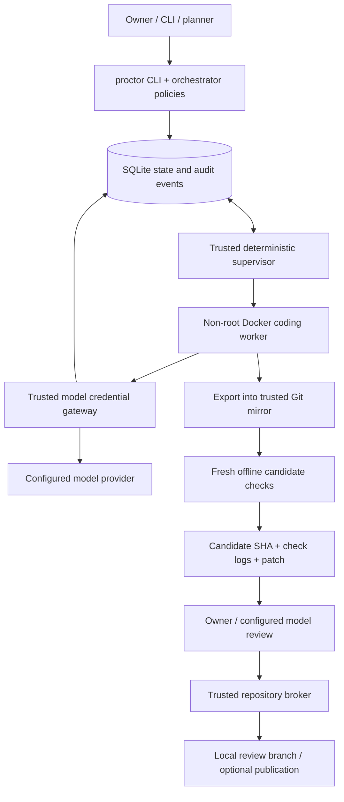

# Proctor

**A supervised execution layer for AI coding agents — they don't grade their own work.**

Turn a scoped task into an isolated worker run, validate the exact resulting commit independently, and retain an auditable review artifact before a human or policy-controlled merge.

Built from a self-hosted deployment; extracted into a public development edition without private project registries, credentials, runtime data, or bundled proprietary harness binaries. This is an early engineering project, not a hosted service or an independently audited sandbox.

## Why it exists

A coding agent saying “tests passed” is not deployment evidence. Proctor separates planning, implementation, validation, and repository publication so that a worker's report cannot substitute for supervisor-run checks.

The interesting work is in the control plane:

- **Durable execution:** SQLite jobs, attempts, events, checks, usage, requests, and notification outbox.
- **Frozen candidates:** export the worker tree into a trusted checkout; validate that candidate rather than trusting the worker's Git metadata.
- **Independent validation:** baseline and candidate checks in fresh offline containers, with bounded repair rounds.
- **Controlled model access:** per-attempt gateway tokens, model allow-lists, usage reservations, metering, and subscription-quota guards.
- **Explicit autonomy:** project-scoped task caps, review capacity, role path restrictions, merge policies, and owner approvals.
- **Recoverability:** container reattachment, stale-attempt rejection, infrastructure retry limits, and best-effort preservation of partial patches.

## Try it without credentials

Linux, Python 3.11+, and Git are sufficient for the offline development path. No third-party Python runtime dependencies are required.

```bash
python3 -m unittest discover -s tests -v
python3 examples/control_plane_demo.py
python3 scripts/check_public_release.py
```

The demo exercises real task-intake and policy code against temporary local state. It **does not** run a coding model, start the Docker supervisor, prove firewall isolation, or demonstrate a successful end-to-end worker job. Its output is produced by execution rather than a canned transcript.

The GitHub Actions workflow defines the offline checks for Python 3.11–3.13. A workflow file is not a claim that hosted CI has already run.

## Install on a host

On a dedicated Linux host with Docker, systemd and Python 3.11+:

```bash
git clone https://github.com/Blabbleu/Proctor.git && cd Proctor
sudo ./install.sh --dry-run        # see every change first
sudo ./install.sh                  # install, start the services, run `proctor doctor`

sudo proctor project add myproj --path /srv/myproj --check 'test=make test'
sudo proctor submit myproj 'Describe a small change' -a 'what done looks like' --harness mock
sudo proctor list
```

A fresh install runs the scripted mock harness with no credentials, picks a free gateway subnet, and stages an installed Claude Code binary if one is on `PATH`. For real models, add API keys to `/etc/proctor/credentials.env`, then set prices and spending ceilings in `/etc/proctor/settings.toml`. To use Claude/ChatGPT subscriptions through Hermes Agent instead of API keys, install with `--hermes`. `sudo ./install.sh --uninstall` removes everything except configuration and job history (`--purge` removes those too). See the [operator guide](docs/deployment.md).

## Architecture



The worker container is the untrusted execution boundary. The broker, supervisor, Docker daemon, project registry, and host are trusted. Docker access is root-equivalent; separate Unix service users do not establish a strong security boundary between those services.

[Architecture and trade-offs](docs/architecture.md) · [Threat model](SECURITY.md) · [Operator setup](docs/deployment.md) · [Planner integration](docs/planner-integration.md)

## Job lifecycle

```text
queued → preparing → baseline validation → implementing
    → export/freeze → candidate validation → publishing → ready_for_review
                           ↓
                  bounded repair → revalidation
```

Other outcomes include `needs_input`, `blocked_environment`, `blocked_budget`, `waiting_quota`, `failed`, `cancelled`, and `interrupted`.

Publication and merge are different operations. The public example defaults to **no automatic merging, no remote push, and no autonomous planning**. Enable each deliberately after configuring a disposable project and testing the complete deployment.

## Read the implementation

| Area | Entry point | Engineering concern |
|---|---|---|
| Job engine | [`supervisor.py`](proctor/supervisor.py) | state transitions, containers, frozen candidates, repair, recovery |
| Model/repo broker | [`broker.py`](proctor/broker.py) | credentials, reservations, quotas, publication, owner-run Git |
| Policy layer | [`orch.py`](proctor/orch.py) | capacity, review, approvals, merge controls |
| Harness adapters | [`harness.py`](proctor/harness.py) | Claude Code / Codex / scripted mock normalization |
| Registry | [`common.py`](proctor/common.py) | TOML validation, roles, paths, model approval |
| Persistence | [`db.py`](proctor/db.py) | schema, events, attempts, requests |
| CLI | [`cli.py`](proctor/cli.py) | intake, idempotency, status, cancellation |

## Scope and limitations

- Live execution targets a dedicated Linux host with Docker, systemd, and iptables compatibility. macOS/Windows live deployment is not supported by these service templates.
- Model credentials come from Anthropic/OpenAI API keys by default. Subscription credentials, subscription-quota readings and Hermes notifications need [Hermes Agent](https://github.com/NousResearch/hermes-agent) (`install.sh --hermes`). Only the Anthropic Messages and OpenAI Responses APIs are routed; this is not a general-purpose provider SDK.
- Model names, CLI versions, endpoint behavior, provider terms, and prices must be checked by the operator. No proprietary CLI binaries or provider credentials are redistributed.
- Budget figures are estimated list-price usage equivalents, not hard billing limits. In-flight requests and estimation error can overshoot; disable provider-side extra usage separately.
- Missing quota readings can permit calls unless `require_fresh` is enabled; a present reading is not continuously fresh on every path.
- Policy checks assume trusted control-plane callers and files. An approval string in a writable decision file is not cryptographic owner authentication.
- Tests in this edition cover offline behavior. The installer, live gateway, container recovery, and network isolation still need a dedicated integration test environment.

## Project status

The execution engine comes from a running private deployment. The public edition is intentionally smaller: generic example configuration, an offline demo and regression suite, CI definition, and a documented live-deployment boundary. See the [release checklist](docs/release-checklist.md) for what must be verified before claiming a public release.

[Contributing](CONTRIBUTING.md) · [Portfolio notes](docs/portfolio.md) · [MIT license](LICENSE)
